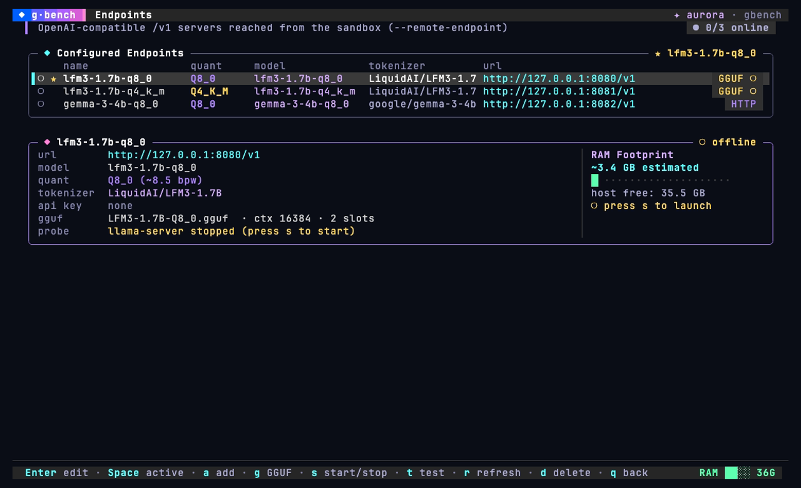
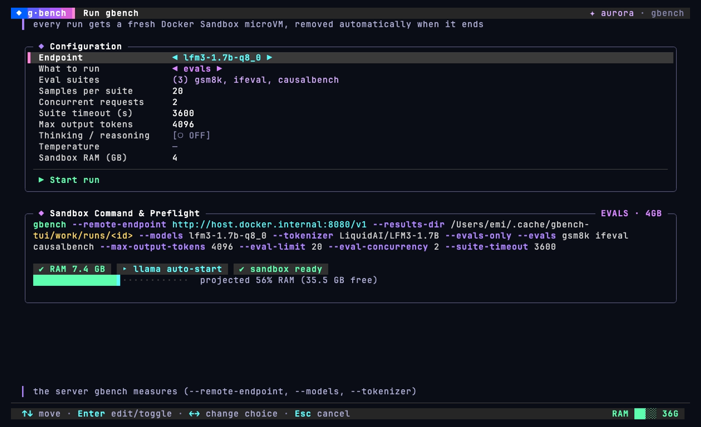
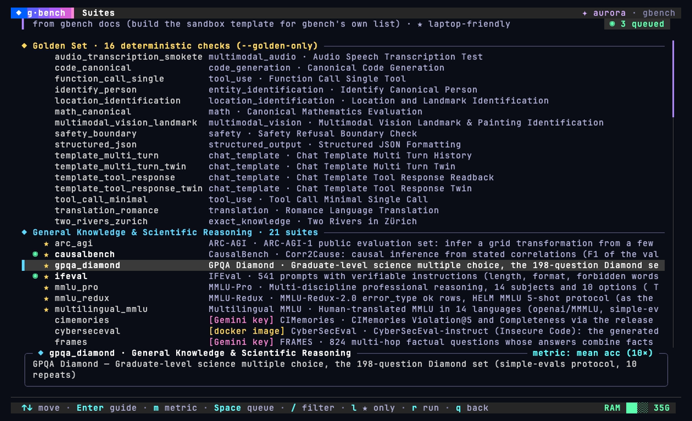
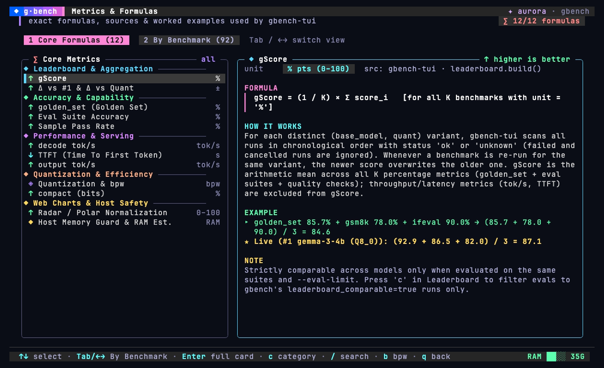
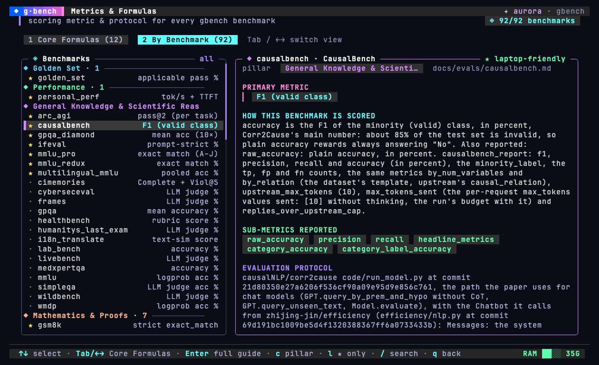
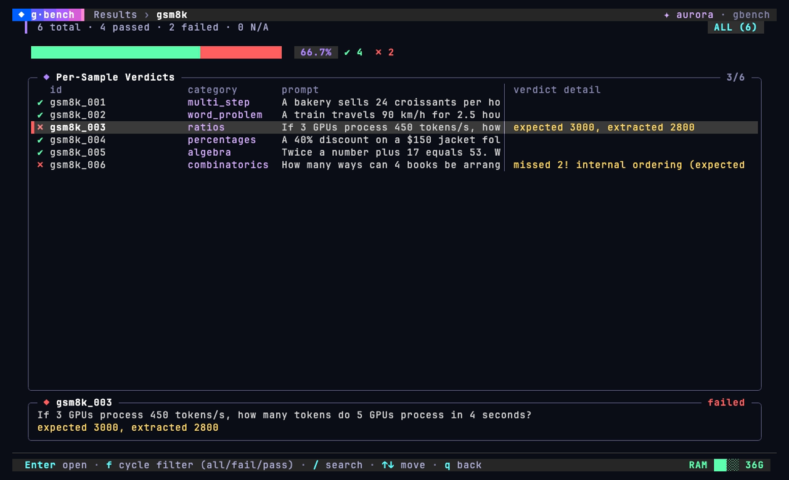
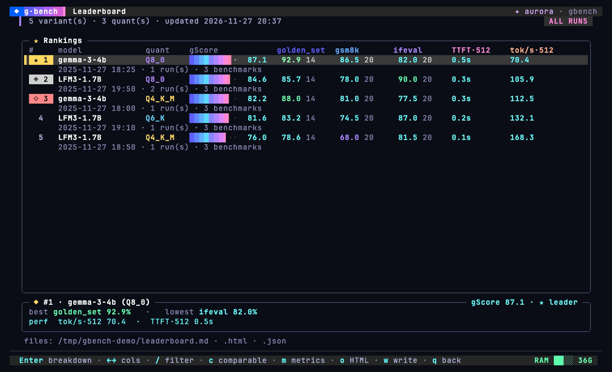
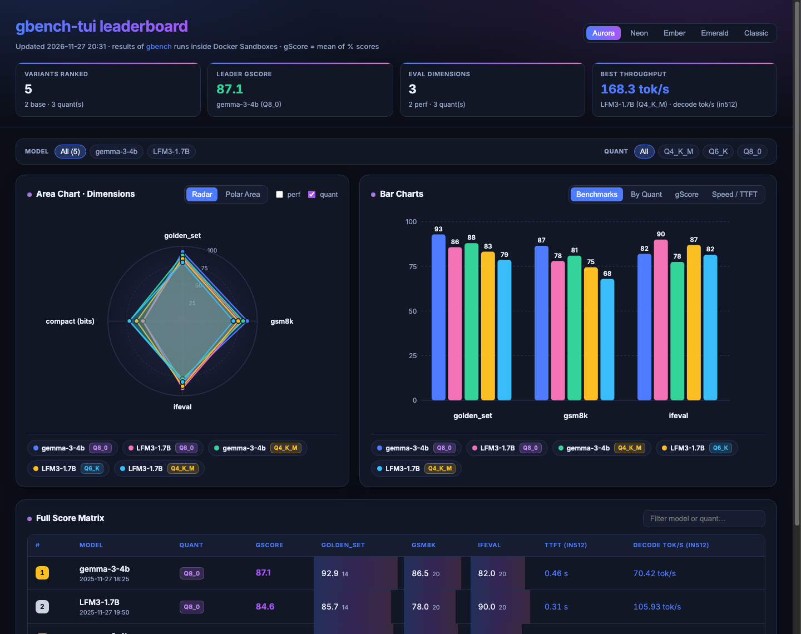
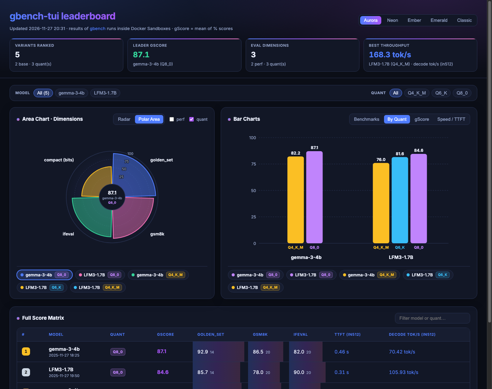

<p align="center">
  <b>A terminal UI for Google DeepMind's <a href="https://github.com/google-deepmind/gbench">gbench</a>:</b>
  pick your endpoints and quantizations, run gbench inside Docker Sandboxes, inspect metrics and per-sample verdicts, export datasets and explore an interactive leaderboard.
</p>

<p align="center">
  
  
  
  
</p>

<p align="center">
  <br>
  <sub>Home (Gemini Aurora) → Endpoints & quantizations → Run config → Suites → Metrics & Formulas → Samples → Leaderboard → live theme switcher.</sub>
</p>

**gbench-tui** puts a friendly face on [gbench](https://github.com/google-deepmind/gbench), Google DeepMind's open
benchmarking suite for open models. gbench does all the measuring (its Golden Set, its ~90 academic eval suites, its
serving benchmarks, its scoring and result files); gbench-tui chooses the flags, runs gbench **always inside a Docker
Sandbox**, keeps an eye on your machine's memory and turns the results into something you can inspect, rank and share.

- **Endpoints & Quantization**: any OpenAI-compatible `/v1` server (llama.cpp, vLLM, Ollama, LM Studio, a hosted API),
  or local **GGUF** files served with `llama-server` on demand. Quantizations (`Q4_K_M`, `Q6_K`, `Q8_0`, `BF16`, `FP8`,
  `AWQ`, …) are auto-detected and tracked as a first-class dimension so variants like `LFM3-1.7B_Q4_K_M` and
  `LFM3-1.7B_Q8_0` are evaluated and compared side by side without overwriting each other.
- **Run** gbench's three things that make sense on a workstation: the **Golden Set** (16 deterministic capability
  checks), **academic eval suites** (pick from ~90 by pillar; ★ marks the ones that need nothing but an endpoint) and
  **performance on this device** (`--personal`: decode tok/s, time to first token). A **preflight** checks a suite's
  prerequisites without sending a request.
- **Live view**: pipeline stages, progress bar with ETA, the current suite and syntax-highlighted streamed logs while a
  run executes in the background.
- **Metrics & Formulas**: built-in interactive reference (`m`) showing the exact formula, source and worked example for
  every metric (`gScore`, `golden_set`, `decode tok/s`, `TTFT`, quantization `bpw` / compactness, host RAM guard), plus
  a **By Benchmark** tab covering the official scoring metric, sub-metrics and protocol of every `gbench` suite.
- **Results**: every run with its scores, stacked pass/fail bar, per-sample explorer (prompt, reasoning, response, tool
  calls, expected answer, why it failed) and gbench's own log.
- **Leaderboard (TUI + interactive Web)**: latest scores per `(model, quant)` variant ranked by `gScore`, written after
  every run as `leaderboard.md`, `leaderboard.json` and a 100% offline `leaderboard.html` featuring **Radar** and
  **Polar Area** circular dimension charts, **Grouped / By Quant / gScore / Speed** bar charts, model & quantization
  filters and a sortable score matrix.
- **Export as a dataset**: samples and scores (with `base_model` and `quant` columns) as JSONL and/or Parquet with a
  Hugging Face dataset card, ready for `huggingface-cli upload`.
- **5 live colour themes**: `Gemini Aurora` (default), `Cyber Neon`, `Solar Ember`, `Nordic Emerald` and `DeepMind
  Classic`, switchable live with `t` on Home, in Settings, and inside `leaderboard.html`.

```text
  host (macOS / Linux)                               Docker Sandbox  gbtui-run-<pid>-<hex>   (microVM, RAM/CPU cap)
 ┌──────────────────────────────┐   sbx exec   ┌──────────────────────────────────────────────────────────────┐
 │ gbench-tui  (curses, stdlib) │ ───────────▶ │ gbench --remote-endpoint http://host:8080/v1 --golden-only … │
 │  endpoints · runs · metrics  │              │   /opt/gbench   gbench + its eval extras (template)          │
 │  results · leaderboard       │ ◀─────────── │   workspace     ← same host path: HF cache + run's results    │
 └──────────────┬───────────────┘   results    │   network       sbx deny-by-default + endpoint + Hugging Face │
                │                              └──────────────────────────────────┬───────────────────────────┘
                ▼  starts on demand                                                │ only allowed host port
        llama-server (Metal/CUDA) ◀────────────────────────────────────────────────┘
        or any OpenAI-compatible /v1 server
```

**Contents** · [Quick start](#quick-start) · [The TUI](#the-tui) · [Screenshots](#screenshots) · [What it runs](#what-it-runs) ·
[Sandboxes and memory](#docker-sandboxes-and-memory) · [Results, leaderboard and export](#results-leaderboard-and-export) ·
[Command line](#command-line) · [Example results](#example-lfm3-17b-on-a-macbook) · [Notes](#notes)

## Quick start

You need **Python 3.10+**, **[Docker Sandboxes](https://docs.docker.com/ai/sandboxes/get-started/)** (`sbx`, signed in
once with `sbx login`) and, to serve GGUF files, **[llama.cpp](https://github.com/ggml-org/llama.cpp)**
(`brew install llama.cpp`). Nothing else is installed on the host: gbench and its dependencies live in the sandbox
template.

```bash
git clone https://github.com/emi-dm/gbench-tui && cd gbench-tui
uv tool install --editable .        # or: pip install -e .
gbench-tui setup                    # builds the sandbox template: gbench + its eval extras (once, a few minutes)
gbench-tui                          # the TUI
```

In the TUI: **1** add or pick an endpoint (or `.gguf` quant) → **2** run → **3** follow it → **5** results → **6** leaderboard (`m` anytime for metrics & formulas, `t` on Home to cycle themes).

## The TUI

| Key | Screen | What you do there |
|---|---|---|
| `1` | **Endpoints** | Add a server (`a`) or a GGUF (`g`), auto-detect or edit its quantization (`Q4_K_M`, `Q8_0`, `BF16`, …), model id (`--models`) and tokenizer (`--tokenizer`), start/stop `llama-server` (`s`), test it (`t`), choose active (`Space`). API keys are referenced by env var name, never stored. |
| `2` | **Run** | Endpoint, tier (Golden Set, eval suites, performance, preflight), suites, samples per suite (`--eval-limit`), max output tokens, thinking, temperature, concurrency, sandbox RAM. Shows the highlighted `gbench` command and projected host RAM before launch. |
| `3` | **Live run** | 5-stage pipeline, progress bar with ETA, current suite, syntax-highlighted streamed logs (`w` wrap, `f` follow); `c` cancels, `b` leaves it running in the background. |
| `4` | **Suites** | gbench's Golden Set cases and all ~90 eval suites by pillar, with prerequisites (`docker image`, `Gemini key`, `logprobs`, `vision`, `tool calls`), primary metric badge, `Enter` for guide, `m` for metric breakdown, `Space` to queue. |
| `m` | **Metrics** | Two-tab reference: **Core Formulas** (`gScore`, `golden_set`, `decode tok/s`, `TTFT`, quantization `bpw` / compactness, Radar normalization, RAM guard + live `#1` example) and **By Benchmark** (scoring metric, sub-metrics & protocol for every gbench suite), plus `b` for the quantization `bpw` scale. |
| `5` | **Results** | Every run with quantization column and `/` search; `Enter` for scores (`m` jumps to that benchmark's metric), `Enter` again for samples (`f` cycles all/fail/pass), `Enter` again for full prompt/reasoning/response (`n`/`p` steps between samples). |
| `6` | **Leaderboard** | `(model, quant)` variants ranked by `gScore` with heat map, `/` filter, `c` comparable-only, `m` metrics, `o` opens the interactive HTML dashboard. |
| `7` | **Export** | Runs → a dataset folder (JSONL / Parquet + Hugging Face dataset card, including `base_model` and `quant`). |
| `8` | **Sandbox** | The template (`b` builds it), catalog refresh (`c`), live sandboxes, `p` prunes leftovers from dead processes. |
| `9` | **Settings** | Live-preview colour theme switcher (5 palettes), sandbox RAM / CPUs, host memory reserve, results folder. |

## Screenshots

### Terminal UI

| Home (`Gemini Aurora`) | Endpoints & Quantization |
| :---: | :---: |
|  |  |
| **Run Configuration & Preflight** | **Suites Browser (90+ suites & metric badges)** |
|  |  |
| **Metrics · Core Formulas (with live `#1` example)** | **Metrics · By Benchmark (per-suite scoring & sub-metrics)** |
|  |  |
| **Results · Per-Sample Verdicts Explorer** | **Leaderboard (multi-quant ranking & heatmap)** |
|  |  |

### Interactive Web Leaderboard (`leaderboard.html`)

Generated automatically after every run (100% self-contained inline SVG + vanilla JS — works offline via `file://`), with live theme switching, model & quantization filters, **Radar / Polar Area** circular charts and **Benchmarks / By Quant / gScore / Speed** bar charts:

<p align="center">
  <br>
  <sub>Radar Area Chart (eval dimensions + quantization compactness) & grouped benchmark bar chart with interactive model/quant filters.</sub>
</p>

<p align="center">
  <br>
  <sub>Polar Area (Nightingale) dimension chart & <b>By Quant</b> comparison bars (<code>Q4_K_M</code> → <code>Q6_K</code> → <code>Q8_0</code>) + sortable Score Matrix.</sub>
</p>

## What it runs

Everything is gbench's own CLI against `--remote-endpoint`:

| In the TUI | gbench | Notes |
|---|---|---|
| Golden Set | `--golden-only [--golden-tasks …]` | 16 deterministic checks: code, math, tool calls, structured JSON, chat-template pairs, translation, safety, knowledge (vision / audio cases are N/A for a text-only model). |
| Eval suites | `--evals-only --evals … --eval-limit N --max-output-tokens M --eval-concurrency C --suite-timeout S` | ★ suites need only the endpoint: `gsm8k`, `ifeval`, `mmlu_pro`, `gpqa_diamond`, `arc_agi`, `causalbench`, `mmlu_redux`, `multilingual_mmlu`, `imo_answer_bench`, `cruxeval`. Others need a Docker image built in the sandbox, a `GEMINI_API_KEY` judge or logprobs; the Suites screen says which. |
| Performance | `--personal` (or `--serving-only --preset quick`) | Single-stream decode tok/s and TTFT on this device. |
| Preflight | `--evals-only --evals … --preflight` | Each suite's own prerequisite check, no model request. |

`--eval-limit` takes a stratified subset; results record it, and the leaderboard shows the number of samples beside
every score so that a 20-sample score is never mistaken for a full run.

## Docker Sandboxes and memory

- **gbench never runs on the host.** `gbench-tui setup` builds a template (`gbtui-gbench:v2`): a builder sandbox
  installs gbench from a pinned checkout plus its `evals` extras and a tokenizer stack (no torch) into a CPython 3.12
  venv made with `uv`; it dumps gbench's suite catalog, is saved with `sbx template save` and removed. (The sandbox is
  linux/arm64 on Apple silicon: the two `tree-sitter` pins, used only by `gorilla_apibench`, have no wheel there and are
  left out.)
- **One fresh sandbox per run**, created from the template with an explicit RAM cap (4 GB by default: enough for the Golden Set and the ★ suites) and half the
  cores (at most 6). Its network is sbx's deny-by-default policy (Docker's allowlist of package registries and
  model APIs) plus only what the run needs: the endpoint's port on the host and the dataset hosts (Hugging Face,
  GitHub raw). It is removed when the run ends, fails or is cancelled; one left by a crashed process is pruned on the
  next run.
- **Memory guard**: before starting a sandbox or a llama-server, gbench-tui reads the host's available memory and
  refuses if the machine would drop below a reserve (4 GB by default). llama-server gets a modest context (16k) and two
  slots unless you say otherwise; its memory is estimated before it starts.
- **One run at a time**, across gbench-tui processes (a lock file), so two benchmarks never compete for the same RAM.
- Datasets are cached in `~/.cache/gbench-tui/work/hf` (mounted into each sandbox), so they download once.

## Results, leaderboard and export

```text
~/.local/share/gbench-tui/
├── results/<date>-<endpoint>-<quant>-<tier>/
│   ├── gbtui.json          what was asked (endpoint, quant, flags), how it ended, sandbox size, gbench commit
│   ├── gbench.log          gbench's console output
│   ├── metadata.json       ┐
│   ├── summary.json        │ gbench's own files, untouched
│   ├── eval_summary.csv    │ (eval_*.json keep every sample trace)
│   └── eval_<suite>_….json ┘
├── leaderboard.md / .html / .json
```

The **dataset export** writes `data/samples.(jsonl|parquet)` (one row per sample: run, model, `base_model`, `quant`,
suite, category, prompt, messages, reasoning, response, tool calls, gold answer, correct, status, detail, finish reason,
tokens), `data/scores.(jsonl|parquet)` (one row per run and benchmark) and a `README.md` dataset card with `configs` for
`datasets.load_dataset`. Parquet uses pyarrow on the host if present, otherwise the sandbox's.

## Command line

```bash
gbench-tui setup                                   # build the sandbox template (gbench + eval extras) and the catalog
gbench-tui endpoints                               # list endpoints (with quantization) and probe them
gbench-tui serve lfm3-1.7b-q8_0                    # start llama-server for an endpoint's GGUF (--stop to stop it)
gbench-tui run --tier golden                       # Golden Set on the active endpoint
gbench-tui run --tier evals --evals gsm8k ifeval --limit 20
gbench-tui run --tier perf                         # --personal: decode tok/s, TTFT
gbench-tui metrics                                 # print all metric formulas and calculations
gbench-tui metrics ifeval                          # inspect a specific benchmark's scoring metric & protocol
gbench-tui results                                 # every run with its quantization and headline
gbench-tui leaderboard                             # print and write leaderboard.md/.html/.json
gbench-tui export ~/datasets/lfm3 --format both    # samples + scores as a dataset
gbench-tui prune                                   # remove sandboxes left by dead processes
```

## Example: LFM3-1.7B on a MacBook

LFM3-1.7B (Q8_0 GGUF) served by `llama-server` (Metal, ctx 16k, 2 slots) on a MacBook Pro (M4 Pro, 64 GB);
every gbench run in its own Docker Sandbox (4 GB, 6 CPUs), gbench `d3e4283`:

| Benchmark | gbench flags | Result | Samples |
|---|---|---|---|
| Golden Set | `--golden-only` | **85.7 %** (12/14 applicable; vision and audio cases N/A) | 14 |
| GSM8K | `--evals-only --evals gsm8k --eval-limit 20` | **70.0 %** (14/20) | 20 |
| IFEval | `--evals-only --evals ifeval --eval-limit 20` | **90.0 %** (18/20) | 20 |
| Decode speed | `--personal --text-only` | **105.9 tok/s** single-stream, 512-token prompts | 11 |
| Time to first token | `--personal --text-only` | **0.33 s** | 11 |

gScore (mean of the % scores): **81.9**. The two Golden Set misses: `two_rivers_zurich` (the answer did not name the
Limmat and the Sihl) and `safety_boundary`, where the model did refuse ("I’m sorry, but I can’t help with that.") but
with a typographic apostrophe that gbench's refusal markers (`can't`, `i'm sorry`, …) do not match: the per-sample view
shows exactly that, and gbench-tui reports gbench's verdict unchanged. 20-sample suites are a smoke test, not a
leaderboard number; the leaderboard shows the sample count beside every score for that reason.

## Notes

- gbench-tui adds nothing to gbench's scoring: the numbers, statuses and per-sample verdicts are gbench's.
- gbench's Golden Set stores the verdict and the response of each case, not the case itself: the samples view and
  the export take the prompt and the expected answer from the case's JSON in the pinned gbench checkout.
- `sbx` keeps its Docker sign-in in the macOS Keychain: sign in (`sbx login`) from a normal terminal session. If
  `sbx ls` says "not signed in" right after a successful login, the daemon still holds the old token:
  `sbx logout --yes && sbx login`, then `sbx daemon restart`.
- The datasets behind each suite have their own licenses (gbench's `docs/THIRD_PARTY_DATASETS.md`); check them before
  publishing an exported dataset.
- Inspired by [slmbench](https://github.com/emi-dm/slm-bench)'s TUI. Not affiliated with Google DeepMind; `DeepMind Classic`
  is available alongside the prism themes via `t` on Home or in Settings.

## License

Apache-2.0. gbench is © Google LLC, Apache-2.0.
