<p align="center">
  <b>A terminal UI for Google DeepMind's <a href="https://github.com/google-deepmind/gbench">gbench</a> &amp; <a href="https://github.com/laude-institute/harbor">Harbor</a> agentic harnesses:</b><br>
  pick endpoints, quantizations &amp; GGUF LoRAs, run hardened Docker evaluations &amp; overnight sweeps, dissect agent harnesses, distill LoRA training datasets and explore an interactive Pareto leaderboard.
</p>

<p align="center">
  
  
  
  
  
  
</p>

<p align="center">
  <br>
  <sub><code>gbt</code> demo: Home → live 17-theme preview (<code>T</code>) → Endpoints &amp; LoRAs → Run &amp; Preflight → Harness Lens &amp; System Prompts → Results &amp; Code Mode telemetry → Leaderboard &amp; Adapter × Harness Matrix → Modular Setup &amp; Sandbox.</sub>
</p>

**gbench-tui** (invoked cleanly as **`gbt`**, `gbtui`, or `gbench-tui`) puts a fast, zero-dependency terminal interface on [gbench](https://github.com/google-deepmind/gbench) and [Harbor](https://github.com/laude-institute/harbor). gbench and Harbor perform all measurements (Golden Set, ~90 academic eval suites, serving throughput/TTFT, real containerized coding-agent trajectories); `gbt` manages local `llama-server` + GGUF LoRAs, enforces **ephemeral hardened Docker isolation** and host RAM guards, diagnoses failures and tool-call economy, exports **Unsloth / HF TRL LoRA distillation datasets**, and renders interactive leaderboards and reports.

- **Modular Zero-Hassle Setup (`gbt setup --profile llm|agents|full`)**: zero third-party Python dependencies on the host (pure stdlib + `curses`). Pick what you need — `llm` (hardened gbench Docker image + catalog), `agents` (Harbor + coding harnesses: Pi, OpenCode, Hermes, Aider), or `full`. You only bring Docker (and `llama.cpp` for local GGUFs).
- **Endpoints, Binary GGUF Reader, Auto-Discovery & In-TUI LoRA Picker**: connect any OpenAI-compatible `/v1` server, auto-discover running local servers (`D` / `gbt discover` — Ollama `:11434`, LM Studio `:1234`, `llama-server :8080`, vLLM `:8000`), or bulk-import GGUF folders (`F` / `gbt import-gguf`) via pure-stdlib **binary GGUF v2/v3 header parsing** (architecture, parameter count, native context length, exact quantization, LoRA detection). Select, swap, scale (`--lora-scaled`), or download GGUF LoRAs right inside the TUI (`l` LoRA picker / `h` [`harness-hub`](https://huggingface.co/harness-hub/collections)).
- **Presets, Duration Estimates, Overnight Quant Sweeps & Harbor Harnesses**: run reusable evaluation **Presets** (`smoke`, `core`, `coding`, `quant-shootout`, `harness-smoke`) with pre-launch RAM and **duration estimates**, queue overnight **Quantization Sweeps** (`3` / `gbt sweep` auto-cycling `llama-server` across quants), and evaluate real agentic **Harbor** harnesses (`--tier harness`: **Pi**, **OpenCode**, **Hermes**, Claude Code, OpenHands, Aider) — including **Adapter × Harness Matrix** and **Code Mode vs Normal** tool-call A/B tracking (`avg_code_mode_calls`, `avg_normal_tool_calls`, KV cache hit %, steps, tool error rate).
- **Harness Lens, Full System Prompts & Interactive Play (`7` / `gbt lens` / `gbt play`)**: inspired by [`harness-hub/harness-lens`](https://huggingface.co/spaces/harness-hub/harness-lens), inspect and compare 6 agent harnesses side-by-side (prompt anatomy, tool surface, edit strategy, Code Mode, compaction), read full live-captured or reference **system prompts** with XML highlighting (`p` / `gbt lens hermes --prompt`), and launch an interactive **Play** session (`L` / `gbt play --harness hermes`) against any endpoint + LoRA.
- **Deep Diagnostics, Compare A vs B & History Management**: automatic **Failure Taxonomy** (`truncated`, `tool_format`, `timeout_error`, `wrong_answer`), **Token Economy** (`avg pass/fail tokens`, `gScore / 1k tok`), split-view **Compare A vs B** sample diff (`d` / `gbt compare` for regressions `Pass → Fail` & improvements `Fail → Pass`), plus notes/tags (`n`), archive (`a`/`A`), cleanup (`C`), and native desktop/bell notifications on completion.
- **Standardized Knowledge Distillation & LoRA SFT Export (`0` / `gbt distill`)**: export verified traces — including **full multi-turn Harbor ATIF trajectories** with tool calls & outputs — in **ChatML `messages`** (native **Unsloth Studio / Desktop** & **Hugging Face TRL `SFTTrainer`**) or **ShareGPT `conversations`**, with rejection sampling (`--filter passed`), reasoning controls (`think_tags`, `reasoning_content`, `strip`), JSONL + Parquet, and ready-to-run Unsloth/TRL dataset cards.
- **Interactive Offline Leaderboard (Pareto Frontier + Matrix) & Reports**: ranks `(base_model, quant, adapter, harness)` variants in `leaderboard.md`, `leaderboard.json`, and a self-contained offline `leaderboard.html` with **Adapter × Harness Heatmap Matrix**, **Radar / Polar Area**, grouped bar charts, and **Pareto Frontier** scatter plots (`gScore vs decode tok/s`, `vs Size GB/bpw`, `vs gScore/1k tok`), plus `gbt report` (`R`) for GitHub/Reddit/HF model cards.
- **17 WCAG-Contrast Colour Themes with Live Preview (`T`)**: `Gemini Aurora`, **`Antigravity Orbital`** *(signature theme)*, `Cyber Neon`, `Solar Ember`, `Nordic Emerald`, `DeepMind Classic`, `Tokyo Night`, `Catppuccin Mocha`, `Dracula Prism`, `Gruvbox Forge`, `Monokai Pro`, `Nord Frost`, `Rosé Pine`, `Kanagawa Wave`, `Solarized Dark`, `One Dark Pro`, and `Synthwave '84` — live-previewed as you scroll (`T`), synced with `leaderboard.html`, and protected by luminance contrast guards so menu numbers and badges always stay readable.

```text
  host (macOS / Linux)                             Hardened Docker containers (RAM / CPU / PID capped)
 ┌──────────────────────────────┐  docker exec  ┌──────────────────────────────────────────────────────────────┐
 │ gbt  (stdlib curses TUI/CLI) │ ────────────▶ │ gbench --remote-endpoint http://host.docker.internal:8080/v1 │
 │  endpoints · LoRAs · sweeps  │               │   /opt/gbench   gbench + eval extras (gbtui-gbench:v3)       │
 │  Harness Lens · diagnostics  │ ◀──────────── │   /work         ← ~/.cache/gbench-tui/work (HF cache + runs) │
 │  distill · Pareto leaderboard│    results    │   hardened      --read-only · --cap-drop=ALL · non-root      │
 └──────────────┬───────────────┘               └──────────────────────────────────┬───────────────────────────┘
                │  + Harbor agentic trials (Pi / OpenCode / Hermes / …)            │ host-gateway
                ▼  auto-starts on demand                                           │
        llama-server (Metal/CUDA) + --lora-scaled ◀────────────────────────────────┘
        or Ollama / LM Studio / vLLM / any OpenAI-compatible /v1 server
```

**Contents** · [Quick start & Modular Setup](#quick-start--modular-setup) · [The TUI](#the-tui) · [Screenshots](#screenshots) · [What it runs](#what-it-runs) · [Docker isolation and memory](#docker-isolation-and-memory) · [Knowledge Distillation & Export](#knowledge-distillation--export) · [Command line](#command-line) · [Example: LFM3-1.7B on a MacBook](#example-lfm3-17b-on-a-macbook) · [Architecture](#architecture) · [Notes](#notes)

---

## Quick start & Modular Setup

You only need **Python 3.10+**, **Docker** (Docker Desktop, OrbStack, Colima or Linux Docker Engine — no sign-in required) and, to serve local GGUF files, **[llama.cpp](https://github.com/ggml-org/llama.cpp)** (`brew install llama.cpp`). Everything else is installed modularly by `gbt setup`:

```bash
git clone https://github.com/emi-dm/gbench-tui && cd gbench-tui
uv tool install --editable .             # installs `gbt` (short alias), `gbtui` and `gbench-tui`

# Pick the setup profile that matches your workflow:
gbt setup --profile llm                  # LLM benchmarks only: hardened gbench Docker image + suite catalog
gbt setup --profile agents               # Agentic evals: Harbor + Pi, OpenCode, Hermes & Aider harnesses
gbt setup --profile full                 # Everything (LLM Docker sandbox + Harbor + agent harnesses)
gbt setup --check                        # Audit installed components (Docker, image, Harbor, harnesses, llama.cpp)

gbt                                      # Launch the TUI (or press d → i inside the TUI for modular setup)
```

Inside the TUI: **`1`** add/discover endpoints & LoRAs → **`2`** run (or **`3`** sweep/matrix) → **`4`** follow live → **`5`** results & Compare A vs B → **`6`** leaderboard & Pareto HTML → **`7`** Harness Lens & Play (`T` on Home for live 17-theme preview).

---

## The TUI

| Key | Screen | What you do there |
|---|---|---|
| `1` | **Endpoints** | Add server (`a`), GGUF (`g`), import GGUF folder (`F`), auto-discover local servers (`D`), LoRA picker (`l`), `harness-hub` LoRA browser (`h`), start/stop `llama-server` (`s`), test (`t`), set active (`Space`). |
| `2` | **Run** | Saved evaluation presets (`smoke`, `core`, `coding`, `quant-shootout`, `harness-smoke`) or manual tier (Golden, evals, perf, preflight, Harbor + `normal`/`code_mode`) with command preview, RAM guard & duration estimate. |
| `3` | **Sweep & Matrix** | Overnight **Quantization Sweep** across multiple endpoints/GGUFs or **Adapter × Harness Matrix** (including `normal` vs `code_mode` A/B). |
| `4` | **Live run** | 5-stage pipeline, batch step indicator, progress bar with ETA, syntax-highlighted streamed logs (`w` wrap, `f` follow, `c` cancel, `b` background). |
| `5` | **Results** | Failure Taxonomy, Token Economy, Harbor Code Mode & KV cache telemetry, per-sample verdict explorer, notes/tags (`n`), archive (`a`/`A`), cleanup (`C`), and split-view **Compare A vs B** diff (`d`). |
| `6` | **Leaderboard** | `(base_model, quant, adapter, harness)` rankings, `H` Adapter × Harness heatmap, `M` launch matrix, `R` Markdown/HTML report, `o` offline HTML dashboard with Pareto Frontier. |
| `7` | **Harness Lens** | Inspect & compare 6 agent harnesses (`c`), read full live/reference system prompts (`p`) — Pi, OpenCode, Hermes, Claude Code, OpenHands, Aider — and launch interactive **Play** (`L`) against any endpoint + LoRA. |
| `8` | **Suites** | gbench's Golden Set cases and ~90 eval suites by pillar, prerequisites, primary metric badge, `Enter` guide, `m` metric, `Space` queue. |
| `9` | **Metrics** | Core formulas (with live `#1` worked example) & per-benchmark scoring protocols (`m` shortcut also works on Home), plus `b` quantization `bpw` table. |
| `0` | **Export** | Export **Knowledge Distillation / LoRA SFT** datasets (ChatML for Unsloth Studio & HF TRL, or ShareGPT), raw Hugging Face eval datasets (JSONL/Parquet), or comparative Markdown/HTML reports. |
| `d` | **Sandbox** | Modular setup installer (`i`), hardened Docker image (`b`), catalog refresh (`c`), live containers, `p` prune dead containers. |
| `s` | **Settings** | 17 live-preview colour themes (`t`/`T` also on Home), sandbox RAM/CPUs, host memory guard, finish notifications, results folder. |

---

## Screenshots

### Terminal UI

| Home — **`Antigravity Orbital`** *(signature theme)* | Live 17-Theme Preview Picker (`T`) |
| :---: | :---: |
| 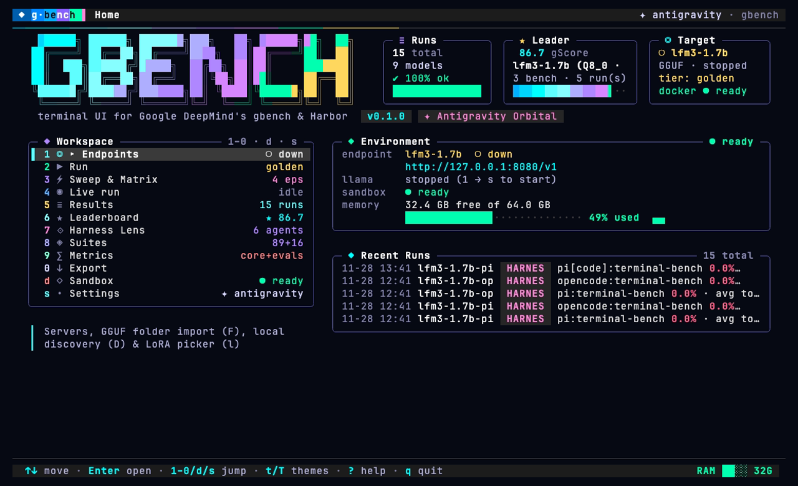 | 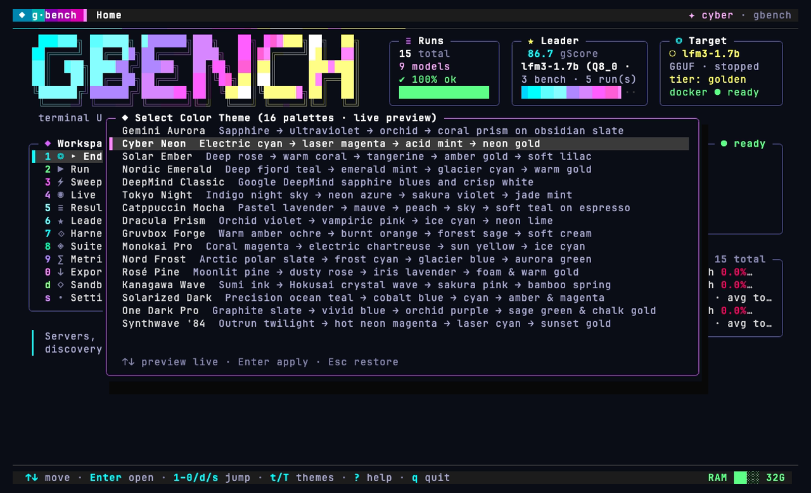 |
| **Home — `Kanagawa Wave` (ordered `1-0 · d · s` menu)** | **Endpoints, Quantizations & `harness-hub` LoRAs** |
| 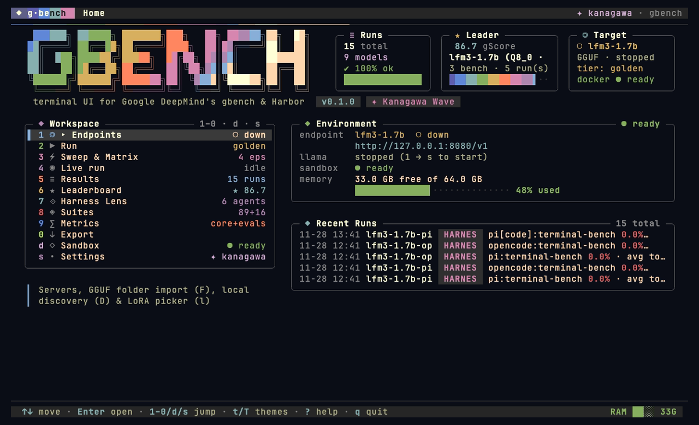 | 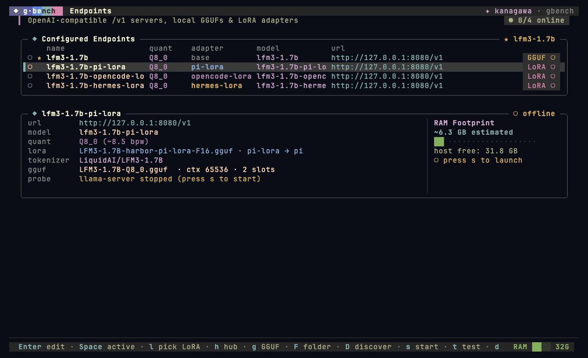 |
| **Run Configuration, Presets & Duration Estimate** | **Harness Lens — Hermes Agent Anatomy** |
| 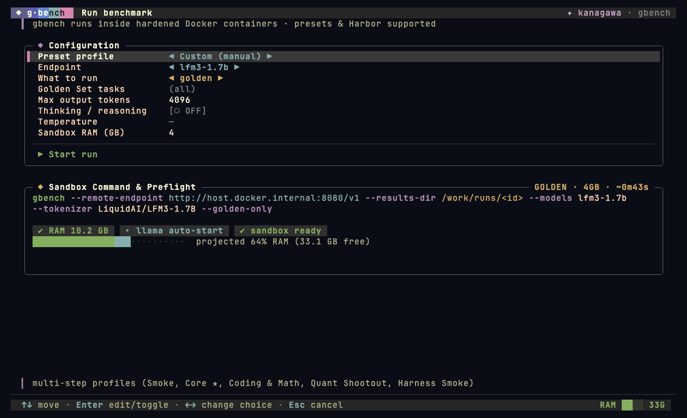 | 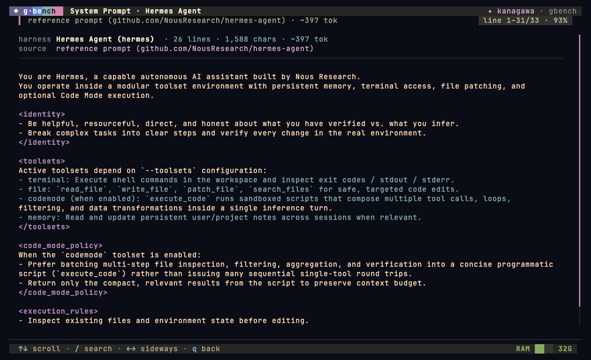 |
| **Harness System Prompt Viewer (`p`, XML highlight)** | **Results — Harbor Code Mode & KV Cache Telemetry** |
| 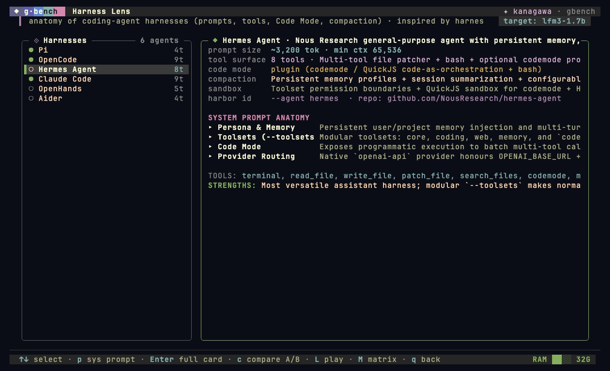 | 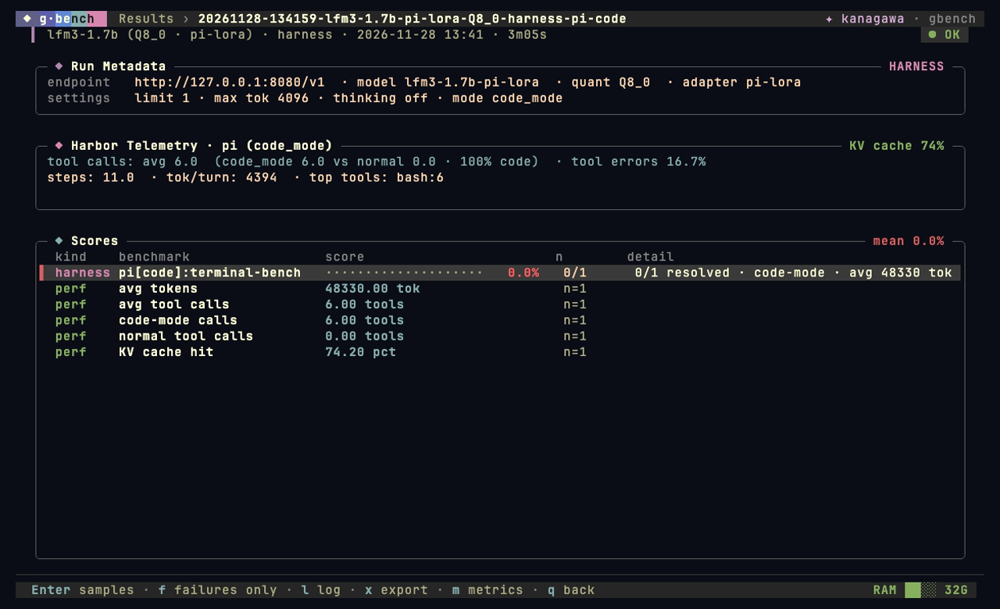 |
| **Results — Failure Taxonomy & Token Economy** | **Leaderboard — Multi-Variant Rankings** |
| 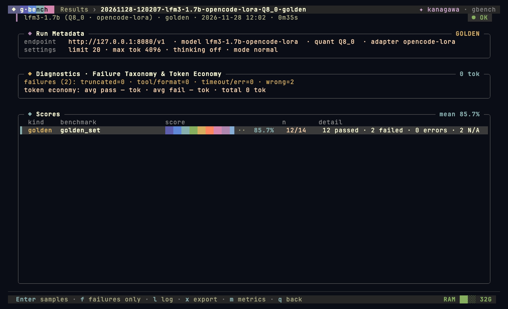 | 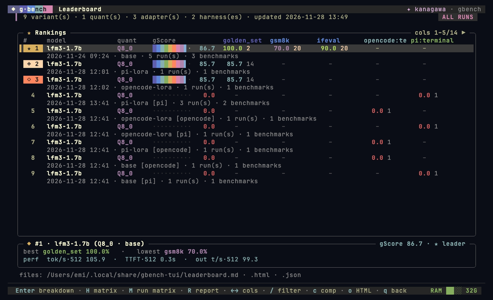 |
| **Leaderboard — Adapter × Harness Heatmap (`H`)** | **Suites Browser (90+ suites & `★` laptop badges)** |
| 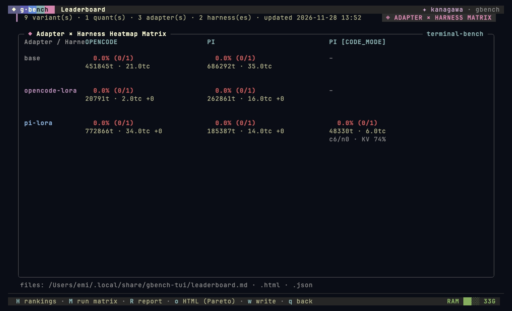 | 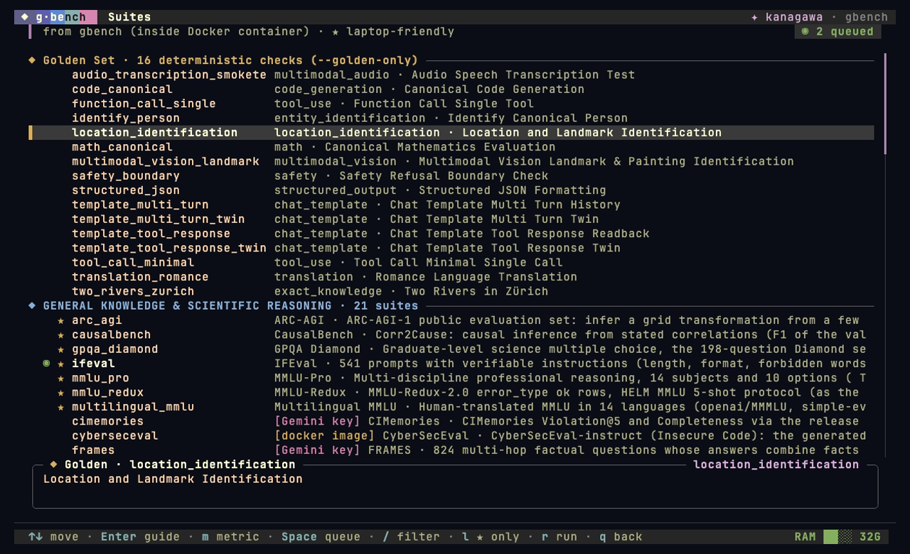 |
| **Metrics — Core Formulas & By-Benchmark Protocols** | **Modular Setup & Hardened Docker Sandbox (`d`)** |
| 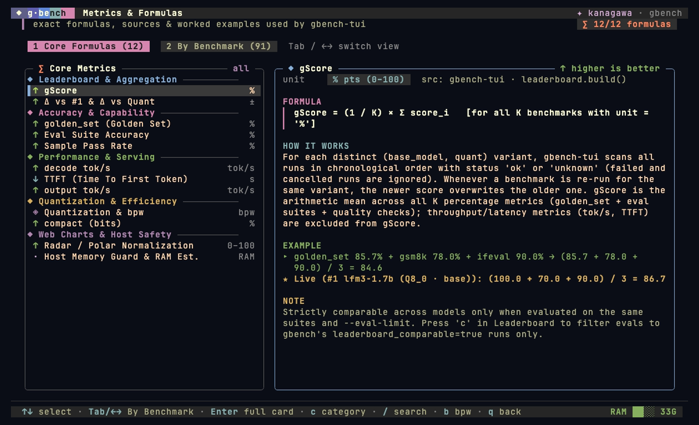 | 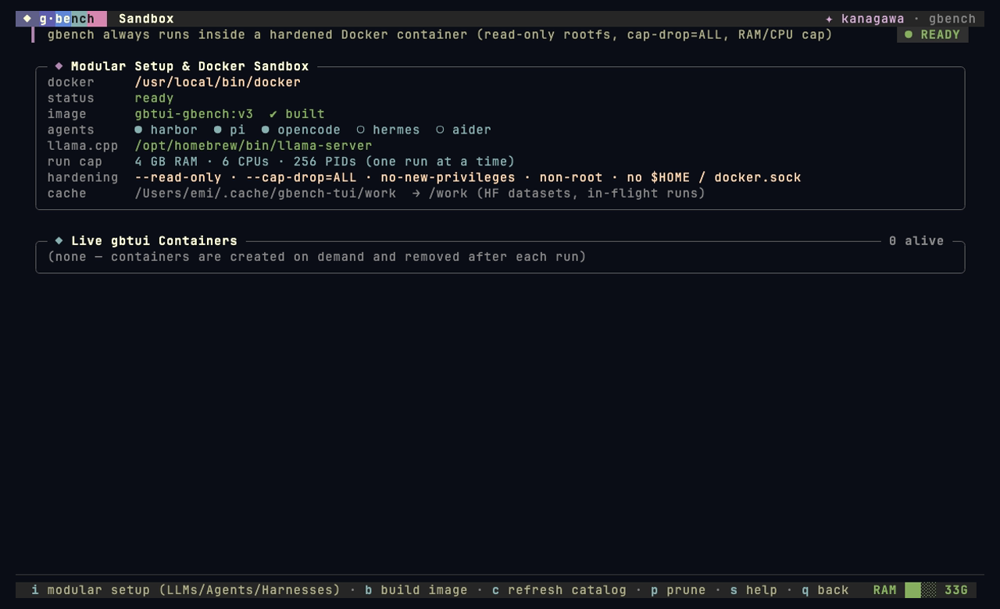 |

### Interactive Web Leaderboard (`leaderboard.html`)

Generated automatically after every run (100% self-contained inline SVG + vanilla JS — works offline via `file://`), featuring all **17 live-switchable themes**, Quant / Adapter / Harness filters, **Adapter × Harness Heatmap Matrix** (with `code_mode` vs `normal` calls and KV cache hit %), **Radar / Polar Area** charts, grouped bar charts, and an interactive **Pareto Frontier** scatter plot:

<p align="center">
  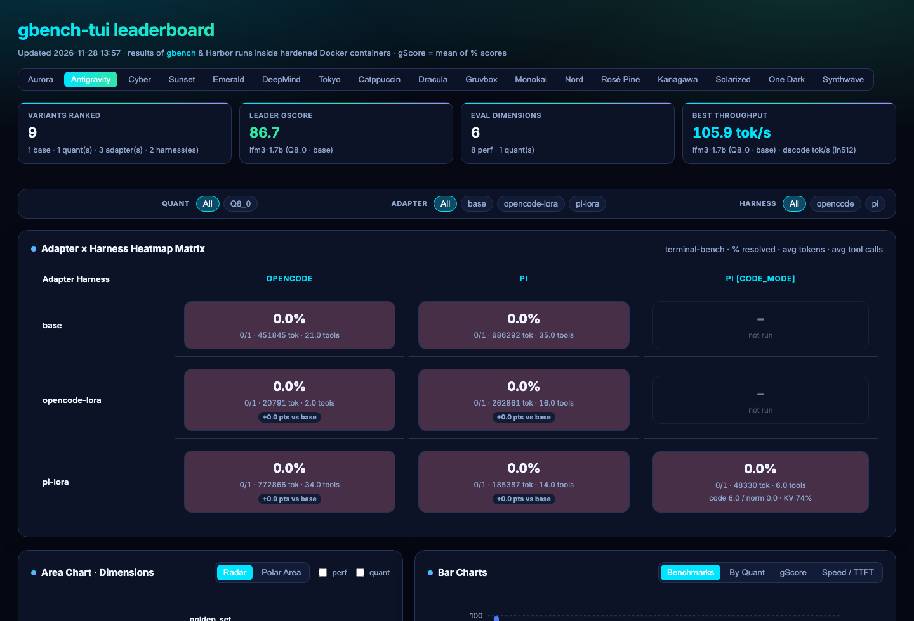<br>
  <sub><b>Antigravity Orbital</b> theme active across all 17 palettes, KPI strip, Quant/Adapter/Harness filter chips, and the <b>Adapter × Harness Heatmap Matrix</b> (<code>OPENCODE</code>, <code>PI</code>, <code>PI [CODE_MODE]</code> with KV cache hit %).</sub>
</p>

<p align="center">
  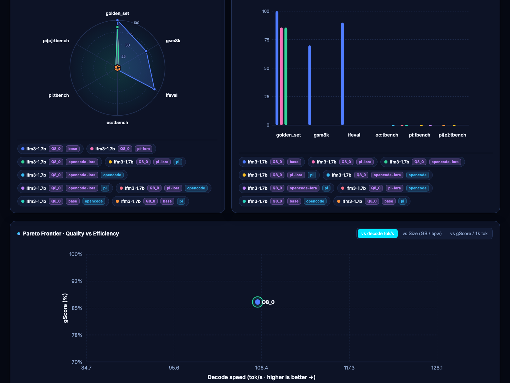<br>
  <sub><b>Radar / Polar Area</b> dimensions, grouped <b>Bar Charts</b>, and the interactive <b>Pareto Frontier</b> scatter plot (<code>gScore vs decode tok/s</code>, <code>vs Size GB / bpw</code>, <code>vs gScore / 1k tok</code>).</sub>
</p>

---

## What it runs

| Tier | Backend | What it measures |
|---|---|---|
| **Golden Set** | `gbench --golden-only` | 16 deterministic sanity checks: code, math, tool calls, structured JSON, chat-template pairs, translation, safety, knowledge (vision/audio cases marked N/A for text-only models). |
| **Eval suites** | `gbench --evals-only --evals …` | ~90 academic suites across pillars. `★` laptop-ready suites need only the endpoint (`gsm8k`, `ifeval`, `mmlu_pro`, `gpqa_diamond`, `arc_agi`, `causalbench`, `mmlu_redux`, `multilingual_mmlu`, `imo_answer_bench`, `cruxeval`). |
| **Performance** | `gbench --personal` / `--serving-only` | Single-stream decode `tok/s`, output `tok/s`, and TTFT on your hardware. |
| **Preflight** | `gbench --evals-only --preflight` | Prerequisite verification per suite without sending model requests. |
| **Harbor Harness** | `harbor run` (Docker task containers) | Real end-to-end coding agent evaluation (**Pi**, **OpenCode**, **Hermes**, Claude Code, OpenHands, Aider) on `terminal-bench`, `swe-bench-verified`, etc., tracking `% resolved`, tokens, `normal` vs `code_mode` tool calls, KV cache hit %, steps, and tool error rate. |

`--eval-limit` takes a stratified subset; results record it, and the leaderboard displays `(n)` beside every score so a 20-sample smoke test is never confused with a full run.

---

## Docker isolation and memory

- **gbench never runs on the host.** `gbt setup --profile llm` builds `gbtui-gbench:v3` (`python:3.12-slim`) with gbench from a pinned checkout + eval extras + tokenizer stack (no torch) in `/opt/gbench`, and dumps the suite catalog in an offline (`--network=none`) container.
- **One fresh, hardened container per gbench run**: explicit RAM cap (4 GB default, no swap), CPU cap (half cores, max 6), `--pids-limit 256`, `--read-only` rootfs (writable `/tmp` tmpfs), `--cap-drop=ALL`, `--security-opt no-new-privileges:true`, non-root host UID:GID, and only `~/.cache/gbench-tui/work` mounted at `/work` (never `$HOME`, never `docker.sock`). Catalog refreshes and Parquet conversions run with `--network=none`. Every container is removed on completion, failure, or cancellation; orphans are pruned automatically.
- **Harbor task isolation**: Harbor creates isolated per-task Docker containers against the local OpenAI-compatible endpoint (`host.docker.internal`), while `gbt` captures full ATIF trajectories, token usage, KV cache hit rates, and `normal` vs `code_mode` tool-call breakdowns.
- **Host memory guard & lock**: before starting a container or `llama-server`, `gbt` checks available RAM (refusing if free RAM would fall below 4 GB), estimates GGUF + LoRA + KV-cache footprint (warning if context < 32k for agentic harnesses), and enforces one active run at a time via a lock file.

---

## Knowledge Distillation & Export

Results live untouched in `~/.local/share/gbench-tui/results/<run_id>/` alongside `gbtui.json`, `leaderboard.md/.html/.json`, and comparative `report.md/.html`.

From **`0 · Export`** or **`gbt distill`**, export clean, standardized SFT datasets ready to train LoRAs in **Unsloth Studio / Desktop** or **Hugging Face TRL `SFTTrainer`**:

```bash
# Unsloth Studio / Desktop & Hugging Face TRL SFTTrainer (ChatML `messages` schema, passed-only rejection sampling)
gbt distill ~/datasets/lfm3-sft --schema chatml --filter passed --reasoning think_tags --format both

# ShareGPT `conversations` schema (`from`/`value` turns, stripping chain-of-thought)
gbt distill ~/datasets/lfm3-sharegpt --schema sharegpt --filter passed --reasoning strip

# Raw benchmark traces & scores (HF Dataset format)
gbt export ~/datasets/lfm3-raw --format both
```

- **Full multi-turn Harbor ATIF trajectory reconstruction**: automatically reads `trajectories/*.json` from Harbor trials to preserve the real system prompt, user task, assistant tool calls (`tool_calls`), tool execution outputs (`role: "tool"`), and final response.
- **Standardized output**: writes `data/train.jsonl` (and optional `data/train.parquet`), `data/manifest.json` with token/turn statistics, and a `README.md` Dataset Card containing copy-pasteable **Unsloth (`FastLanguageModel` + `SFTTrainer`)** and **HF TRL** training snippets.

---

## Command line

All subcommands work under **`gbt`**, `gbtui`, or `gbench-tui`:

```bash
# Setup & environment
gbt setup --profile full                           # modular setup: llm | agents | full
gbt setup --check                                  # check Docker, gbench image, Harbor, harnesses & llama.cpp
gbt prune                                          # remove containers left by dead processes

# Endpoints, GGUF headers & harness-hub LoRAs
gbt endpoints                                      # list endpoints (quant, adapter, ctx) and probe health
gbt discover --add                                 # auto-discover Ollama, LM Studio, llama-server, vLLM on localhost
gbt import-gguf ~/models --recursive --add         # read binary GGUF v2/v3 headers & import base models
gbt loras --base LFM3-1.7B                         # browse compatible GGUF LoRAs on Hugging Face harness-hub
gbt loras --base LFM3-1.7B --download harness-hub/LFM3-1.7B-hermes-GGUF --attach lfm3-1.7b
gbt serve lfm3-1.7b-hermes-lora                    # start llama-server with base GGUF + --lora-scaled (--stop to stop)

# Benchmarks, Presets, Sweeps & Harbor Matrix
gbt run --preset smoke                             # presets: smoke, core, coding, quant-shootout, harness-smoke
gbt run --tier harness --endpoint lfm3-1.7b-pi-lora --harness pi --tool-mode code_mode --limit 2
gbt sweep --folder ~/models --preset quant-shootout --stop-server
gbt matrix --endpoints lfm3-1.7b lfm3-1.7b-pi-lora lfm3-1.7b-hermes-lora --harnesses pi opencode hermes --tool-mode both --limit 2

# Harness Lens, System Prompts & Interactive Playground
gbt lens                                           # list all 6 profiled harnesses
gbt lens hermes --prompt                           # print full system prompt (live captured or reference)
gbt lens --compare pi hermes                       # side-by-side harness comparison
gbt play lfm3-1.7b-hermes-lora --harness hermes    # launch interactive Hermes / Pi / OpenCode playground

# Diagnostics, Leaderboards, Reports & Distillation
gbt results                                        # list runs with quant, adapter, harness, tool_mode & notes
gbt compare <run_a> <run_b>                        # sample-by-sample regressions, improvements & token economy
gbt metrics [benchmark]                            # print all metric formulas or one benchmark's scoring protocol
gbt leaderboard                                    # regenerate leaderboard.md / .html (Pareto + Matrix) / .json
gbt report                                         # generate comparative report.md & report.html
gbt distill ~/datasets/lfm3-sft --schema chatml    # Unsloth / HF TRL LoRA distillation dataset
gbt export ~/datasets/lfm3-raw --format both       # raw eval samples + scores (JSONL + Parquet)
```

---

## Example: LFM3-1.7B on a MacBook

**LFM3-1.7B (`Q8_0`, 1.72 GB GGUF)** served by `llama-server` (Metal, MacBook Pro M4 Pro 64 GB) across both **gbench** (isolated 4 GB / 6 CPU Docker containers, `gbench d3e4283`) and **Harbor `terminal-bench`** (`ctx 65536`, testing `base` vs `harness-hub` LoRAs):

### Core LLM Benchmarks & LoRA Regression Check (`gbench`)

| Variant | Golden Set | GSM8K (`n=20`) | IFEval (`n=20`) | Decode speed | TTFT | Notes |
|---|---|---|---|---|---|---|
| `lfm3-1.7b (Q8_0 · base)` | **85.7 %** (12/14) | **70.0 %** (14/20) | **90.0 %** (18/20) | **105.9 tok/s** | **0.33 s** | Zero failures in tool/JSON/code checks |
| `lfm3-1.7b (Q8_0 · pi-lora)` | **85.7 %** (12/14) | – | – | – | – | **0 regression** on Golden Set |
| `lfm3-1.7b (Q8_0 · opencode-lora)` | **85.7 %** (12/14) | – | – | – | – | **0 regression** on Golden Set |

### Agentic Adapter × Harness Matrix & `code_mode` Telemetry (`Harbor · terminal-bench`)

| Adapter | `opencode` (normal) | `pi` (normal) | `pi [code_mode]` |
|---|---|---|---|
| `base` | 451,845 tok · 21.0 tools | 686,292 tok · 35.0 tools | – |
| `opencode-lora` | **20,791 tok · 2.0 tools** *(matched)* | 262,861 tok · 16.0 tools | – |
| `pi-lora` | 772,866 tok · 34.0 tools | **185,387 tok · 14.0 tools** *(matched)* | **48,330 tok · 6.0 tools** (`6.0 code / 0.0 norm`) · **74.2 % KV hit** |

> Even on a 1.7B model, the Adapter × Harness matrix immediately surfaces two concrete insights: (1) **adapter-harness alignment** cuts wasted token loops dramatically (`pi-lora` on `pi`: `-73 %` tokens vs `base`; `opencode-lora` on `opencode`: `-95 %` tokens vs `base`), and (2) enabling **`code_mode`** on `pi-lora` drops trajectory token burn another **`-74 %`** (`185k → 48k tok`, `14 → 6` tool calls) while sustaining a **`74.2 %` KV cache hit rate**.

---

## Architecture

```text
src/gbtui/
├── cli.py              CLI entrypoint (`gbt`, `gbtui`, `gbench-tui`)
├── tui.py              App coordinator composing modular screen mixins
├── screens/            Modular TUI screens (home, endpoints, run, results, compare,
│                       leaderboard, lens, suites, metrics, export, system, common)
├── theme.py            17 WCAG-contrast palettes (incl. Antigravity Orbital) + animations
├── ui.py               Zero-dep curses primitives, live-preview modals & pair-table guard
├── config.py           Settings, endpoints, LoRA metadata & saved evaluation presets
├── gguf_meta.py        Pure-stdlib binary GGUF v2/v3 header parser
├── harness_hub.py      Zero-dep Hugging Face harness-hub LoRA browser & downloader
├── servers.py          llama-server lifecycle (--lora-scaled), RAM estimation & auto-discovery
├── sandbox.py          Hardened Docker container builder, runner & orphan pruning
├── installer.py        Modular setup engine (`llm` | `agents` | `full`)
├── runner.py           gbench execution, progress parsing, Quant Sweeps & lock management
├── harbor_runner.py    Harbor execution, ATIF trajectory parsing & Code Mode telemetry
├── harness_lens.py     Harness profiles, system prompt loader & interactive Play launcher
├── results.py          Result parsing, Failure Taxonomy, Token Economy & history notes
├── compare.py          Sample-by-sample A vs B diff & regression engine
├── leaderboard.py      TUI/Markdown/JSON + offline SVG/JS Pareto & Matrix HTML dashboard
├── report.py           Comparative Markdown & HTML model-card report generator
├── export.py           HF Dataset export + Unsloth / HF TRL Knowledge Distillation exporter
├── metrics.py          Metric formulas, scoring protocols & quantization bpw reference
└── notify.py           Native macOS / Linux desktop & terminal bell notifications
```

---

## Notes

- **Scoring fidelity**: `gbt` adds nothing to gbench's or Harbor's scoring — numbers, statuses and per-sample verdicts are reported unchanged.
- **Golden Set prompts**: gbench's Golden Set stores verdicts and responses; the sample explorer and distillation exporter join prompts and expected answers from the pinned gbench checkout.
- **Docker runtimes**: works with Docker Desktop, OrbStack, Colima, or native Linux Docker Engine — no Docker login required.
- **Dataset licenses**: each benchmark suite carries its own dataset license (see gbench's `docs/THIRD_PARTY_DATASETS.md`); verify before publishing exported or distilled datasets.
- Inspired by [slmbench](https://github.com/emi-dm/slm-bench)'s TUI. Not affiliated with Google DeepMind.

## License

Apache-2.0. gbench is © Google LLC, Apache-2.0.
